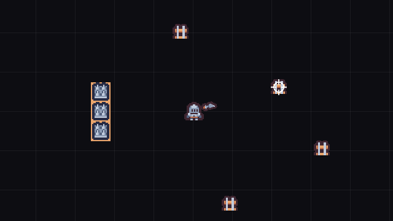
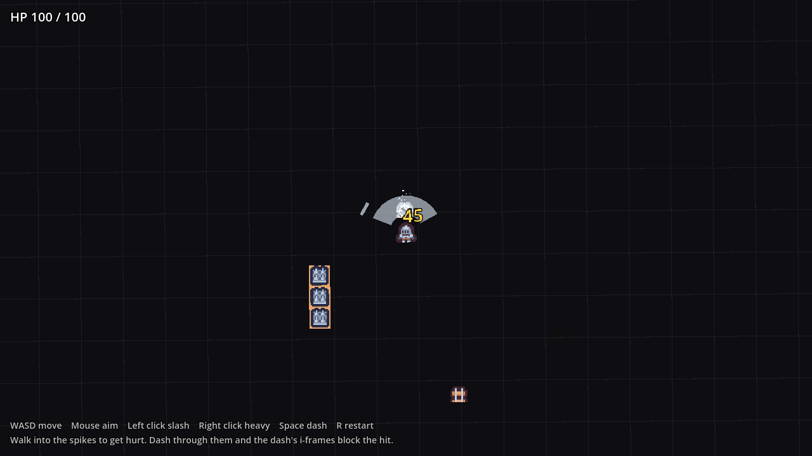

# Godot Hitbox Hurtbox

Health, hitbox and hurtbox components for Godot 4. A passive hitbox deals the
damage, an active hurtbox receives it, and a sword with a quick and a heavy attack
gives you something to test them with.



The crosshair in the GIF stands in for your mouse.

## Features

- **`HealthComponent`**: a drop-in node with `damage()`, `heal()`, `is_alive()`,
  `get_ratio()` and `damaged`, `healed` and `died` signals.
- **`HitboxComponent`**: an `Area2D` that deals damage. It carries `damage`,
  `knockback_force` and `is_crit`, and never reads overlaps itself.
- **`HurtboxComponent`**: an `Area2D` that receives damage. It detects the
  hitbox, applies the damage to its sibling `Health`, knocks its body back, and
  plays the hit flash, impact particles and a damage number.
- **One hit per swing.** A swing hits each target once, even when the hitbox
  overlaps it for several frames. `reset_hits()` starts the next swing.
- **I-frames** with one flag: `hurtbox.invulnerable`. The player's dash sets it,
  so you can dash through damage.
- **A two-attack sword** driven by a small `IDLE -> WINDUP -> ACTIVE -> RECOVERY`
  state machine. The hitbox is only enabled during `ACTIVE`.
- **Impact feel:** hit-stop, screen shake, a directional camera kick and a zoom
  punch on heavy hits, through one `GameManager` autoload.
- **Named physics layers** in `project.godot`, so the layer checkboxes in the
  Inspector say `player_hurtbox` and `enemy_hitbox` instead of numbers.

## Demo



`Main.tscn` is an open arena with:

- three barrels with 20 HP, which break in one hit,
- one tough barrel with 200 HP, so you can watch the numbers, the flash and the
  one-hit-per-swing rule,
- a row of spikes that hurts the player,
- your health in the top left. Press **R** to restart at any time.

Walk into the spikes and you take 15 damage and get knocked back. Dash through
them and the i-frames block the hit.

## Requirements

- Godot **4.7** or later, standard build (GDScript only, no .NET needed).
- Tested on **Godot 4.7.2 stable** on Windows. Earlier 4.x versions are untested.
- Uses the Mobile renderer, which needs Vulkan, Direct3D 12 or Metal.

## Installation

Clone the repository:

```bash
git clone https://github.com/CodingQuests/godot-hitbox-hurtbox.git
```

Or download it with **Code > Download ZIP** and unzip it.

Then open Godot, click **Import**, pick the `project.godot` file inside the folder,
and click **Import & Edit**.

## Quick Start

1. Press **F5**.
2. Move with **WASD** and aim with the **mouse**.
3. **Left click** for a quick slash, **right click** for a heavy attack that winds
   up first.
4. **Space** to dash.
5. Smash the barrels, then walk into the spikes on the left, then dash through
   them.

## How It Works

### The contract

The hitbox is passive and the hurtbox is the active detector. That one rule is
what keeps damage bugs out: there is exactly one place that decides whether a hit
counts.

```gdscript
# HurtboxComponent.gd
func _on_area_entered(area: Area2D) -> void:
	if invulnerable:
		return
	if not area.is_in_group("hitbox"):
		return

	# Make sure a single swing only hits us once.
	if area.has_method("try_register_hit"):
		if not area.try_register_hit(self):
			return
```

After that check it applies the damage, knocks the body back, plays the
feedback and emits `hurt`. The body only needs an `apply_knockback(direction,
force)` method if it should be pushed. Static props like the barrels leave it out.

Every entity that can be hurt has the same three pieces:

```
Body (CharacterBody2D or StaticBody2D)
	Sprite2D
	Health    (HealthComponent)
	Hurtbox   (HurtboxComponent)
		CollisionShape2D
```

### Collision layers

| Layer | Name | Used by |
|---|---|---|
| 1 | `world` | Walls and props the player collides with |
| 2 | `player` | The player's body |
| 3 | `enemy` | Enemy bodies (free for your own enemies) |
| 4 | `player_hurtbox` | The player's hurtbox. It watches layer 7 |
| 5 | `enemy_hurtbox` | Hurtboxes on things the player hits. They watch layer 6 |
| 6 | `player_hitbox` | The player's sword |
| 7 | `enemy_hitbox` | Anything that hurts the player, like the spikes |

A hurtbox only sees hitboxes on the layer in its mask, so the player can never
hit themselves and the spikes can never break a barrel.

### The sword

`WeaponController.gd` arms the hitbox only while a swing is active:

- **Quick slash:** no windup, 20 damage, light hit-stop.
- **Heavy attack:** a 0.25 second windup you can see coming, then 45 damage as a
  crit, a bigger hitbox, heavier hit-stop, shake, kick and zoom punch.

Turning an `Area2D` on or off from inside a physics callback has to be deferred,
or Godot errors with "can't change state while flushing queries". The weapon uses
`set_deferred` for exactly that reason.

### A hazard is just a hitbox

The spike trap has no script of its own. It is a `HitboxComponent` on the
`enemy_hitbox` layer with `hit_once_per_attack` turned off, so it hurts on every
entry. That is the whole point of the components: a sword, a spike and an
enemy's bite all go through the same path.

## Project Structure

```
project.godot                   Project file, layer names, input actions, GameManager autoload
Main.tscn                       The demo arena
scenes/Player.tscn              Player with Health, Hurtbox and the WeaponPivot (sword + AttackHitbox)
scenes/DestructibleProp.tscn    A barrel: StaticBody2D with Health and a Hurtbox
scenes/SpikeTrap.tscn           A HitboxComponent that hurts the player
scripts/HealthComponent.gd      Health, damage, heal, signals
scripts/HitboxComponent.gd      Deals damage. Passive
scripts/HurtboxComponent.gd     Receives damage. Active detector, knockback and feedback
scripts/WeaponController.gd     The two-attack sword and its state machine
scripts/Player.gd               Movement, dash with i-frames, knockback, hurt and death
scripts/DestructibleProp.gd     Breaks the barrel when its health runs out
scripts/GameManager.gd          Autoload: shake, hit-stop, camera kick, zoom punch
scripts/PlayerCamera.gd         Follow camera with shake, kick and zoom punch
scripts/Juice.gd                Static effect helpers: flash, particles, damage numbers
shaders/flash.gdshader          The white hit flash
scripts/Main.gd                 Demo only: grid, health readout, restart
Assets/Tiles/                   Four Kenney Tiny Dungeon tiles (CC0) and their license
```

## Using It In Your Own Game

**The damage system** is four files: `HealthComponent.gd`, `HitboxComponent.gd`,
`HurtboxComponent.gd` and `Juice.gd`, plus `shaders/flash.gdshader`, which the
hurtbox uses for the hit flash.

To make something damageable:

1. Add a `Node` child named `Health` with `HealthComponent.gd`.
2. Add an `Area2D` child named `Hurtbox` with `HurtboxComponent.gd` and a
   collision shape. Put it on a hurtbox layer and set its mask to the hitbox layer
   that should hurt it.
3. Make sure the sprite node is named `Sprite2D`, so the hurtbox can flash it.
4. Connect `Health.died` to whatever should happen on death.

To make something deal damage:

1. Add an `Area2D` with `HitboxComponent.gd` on a hitbox layer, with
   `monitoring` off.
2. Set `damage` and `knockback_force`, and set `source_node` to the attacker so
   knockback pushes away from them.
3. For an attack, enable the shape only during the swing and call `reset_hits()`
   at the start of each swing. For a hazard, turn `hit_once_per_attack` off.

The sword, the player and `GameManager` are optional. Take them if you want the
whole package.

## Customizing It

- **Sword numbers:** the `QUICK_*` and `HEAVY_*` constants at the top of
  `WeaponController.gd` (damage, knockback, timings, hitbox size and reach,
  hit-stop and shake).
- **Armour and weakness:** `damage_multiplier` on any `HurtboxComponent`.
- **Feedback:** `flash_color`, `impact_color` and `show_damage_numbers` on any
  `HurtboxComponent`.
- **Player toughness:** `max_health` on the player's `Health` node, and
  `KNOCKBACK_TAKEN` in `Player.gd` for how far hits shove the player.
- **Barrels:** `max_health` on each `DestructibleProp`.

## Known Limitations

- The hurtbox reacts when a hitbox **enters** it. Standing still inside a hazard
  does not keep hurting you. For damage over time, add a timer that calls
  `health.damage()` while the overlap lasts.
- Hit-stop sets `Engine.time_scale` to 0 for a few hundredths of a second, which
  pauses everything that runs on scaled time, not just the fighters.
- No enemies fight back here. The player's hurtbox is tested with the spike trap.
- No sound. `HurtboxComponent.hurt` and `HealthComponent.died` are the natural
  places to play one.
- Death fades the player out and stops input. There is no game-over screen; the
  demo restarts with R.
- Tested on Godot 4.7.2 on Windows only.

## License

MIT for the code. See [LICENSE](LICENSE).

## Third-Party Assets

The knight, sword, barrel and spike sprites are from
[Tiny Dungeon](https://kenney.nl/assets/tiny-dungeon) by Kenney, released under
CC0 1.0. Details in [THIRD_PARTY_ASSETS.md](THIRD_PARTY_ASSETS.md), and the pack's
original license is in `Assets/Tiles/License.txt`.

## Learn How It Works

Want to understand how this works instead of just copying it?

CodingQuests teaches you how to build systems like this step by step in Godot,
with interactive lessons and real projects.

- **[2D Roguelike: Combat Core](https://codingquests.io/quests/2d-roguelike-combat-core?utm_source=github&utm_medium=resource&utm_campaign=godot_hitbox_hurtbox)**
  builds this damage system lesson by lesson: the health component, the
  hitbox and hurtbox contract, the sword and the dodge. The first 4 lessons are
  free.
- New to Godot? **[2D Roguelike: Top-Down Controller](https://codingquests.io/quests/2d-roguelike-controller?utm_source=github&utm_medium=resource&utm_campaign=godot_hitbox_hurtbox)**
  builds the movement and dash this project starts from. Free, 8 lessons.

## More Free Godot Resources from CodingQuests

Other free, MIT-licensed Godot 4 projects that work well next to this one:

- **[Top-Down Controller](https://github.com/CodingQuests/godot-top-down-controller)**: 8-direction movement, mouse aim, a dash with i-frames and a follow camera with shake.
- **[Enemy AI](https://github.com/CodingQuests/godot-enemy-ai)**: Four enemy types and a three-pattern boss on one shared state machine, with attacks you can read.
- **[Game Feel Lab](https://github.com/CodingQuests/godot-game-feel-lab)**: One sword swing split into seven layers you can switch on and off while the game runs.
- **[Stats and Leveling](https://github.com/CodingQuests/godot-stats-leveling)**: Health and mana pools, attributes, modifiers tagged by source, an XP curve and stat points.

All twelve are listed on the [CodingQuests GitHub profile](https://github.com/CodingQuests).

Made by [CodingQuests](https://codingquests.io/?utm_source=github&utm_medium=resource&utm_campaign=godot_hitbox_hurtbox).
